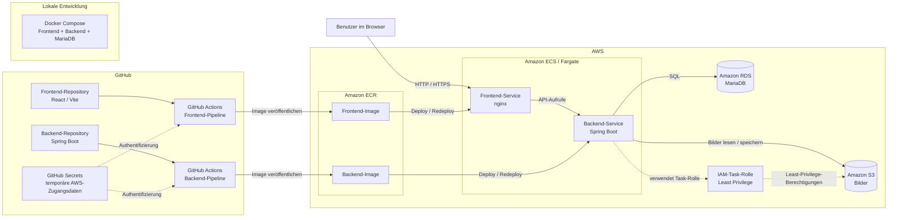
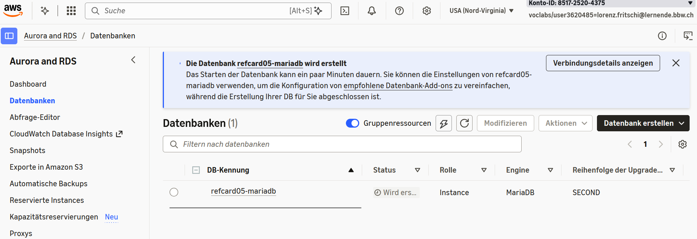
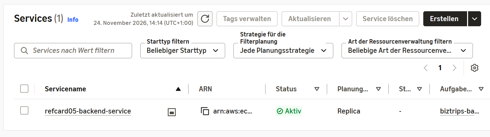
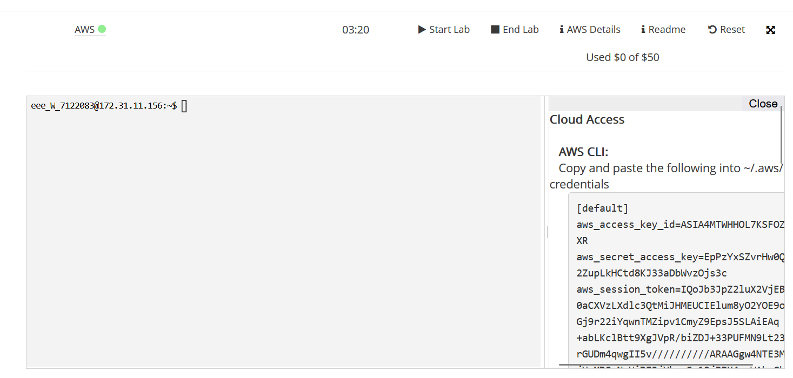

# M324 – RefCard05: Full-Stack-Anwendung auf AWS

> **Hinweis:** Die technischen Beschreibungen unten fassen die Aufgabenstellung zusammen. Wo konkrete Angaben zur Umsetzung fehlen, steht ausdrücklich **Noch ergänzen**. Zugangsdaten, Tokens und Secret-Werte niemals in diese Dokumentation oder in Git einfügen.

## 1. Überblick

**Projekt:** RefCard05 – Full-Stack-Anwendung auf AWS  
**Team / Autorinnen und Autoren:** Lorenz, Elias    
**Datum / Version der Dokumentation:** 17.11.2026  
**AWS-Region:** us-east-1

**Ausgangslage:** RefCard02 behandelte Frontend, GitHub Actions, EC2 und Docker; RefCard03 ergänzte das Spring-Boot-Backend mit MariaDB und CI/CD; RefCard04 behandelte Bilder-Storage als Vorstufe zu S3. RefCard05 führt diese Teile zu einer Full-Stack-Anwendung auf AWS zusammen.

### Ziel

Ziel dieser Lernaufgabe ist es, die bestehende Full-Stack-Anwendung aus React/Vite-Frontend und Spring-Boot-Backend auf AWS bereitzustellen. Frontend und Backend liegen in getrennten GitHub-Repositories und erhalten jeweils eine eigene CI/CD-Pipeline. Diese baut und testet den jeweiligen Dienst, erstellt ein versioniertes Docker-Image und veröffentlicht es im eigenen Amazon-ECR-Repository. Die Images werden als getrennte Services auf Amazon ECS mit Fargate betrieben; Änderungen an den Images sollen ein automatisches Redeployment auslösen.

Das Backend wird mit einer MariaDB-Datenbank auf Amazon RDS verbunden und speichert Bilder in einem Amazon-S3-Bucket. Die RDS-Verbindungsdaten werden konfiguriert, ohne sie im Quellcode abzulegen. Der Zugriff auf den konkreten S3-Bucket wird für den Backend-Task nach dem Least-Privilege-Prinzip begrenzt. Berücksichtigt werden die Einschränkungen des AWS Academy Learner Lab: OIDC und das Erstellen eigener IAM-Rollen sind dort nicht verfügbar; temporäre Session-Zugangsdaten werden als GitHub Secrets verwaltet und bei einer neuen Session erneuert. Zusätzlich soll sich die Anwendung lokal mit Docker Compose (Frontend, Backend und MariaDB) starten lassen, ohne AWS-Zugang.

### Architektur

Die durchgezogenen Pfeile zeigen Daten- und Deployment-Flüsse. Gestrichelte Pfeile zeigen die Verwendung von Zugangsdaten beziehungsweise Berechtigungen. Für die lokale Entwicklung startet Docker Compose Frontend, Backend und MariaDB gemeinsam; dieser Ablauf ist unabhängig von den AWS-Services. Das Diagramm zeigt die in der Aufgabe vorgesehene Architektur, nicht den Nachweis, dass alle Services bereits erfolgreich eingerichtet sind.

## 2. Repositories und Zuständigkeiten

| Bereich | Repository | Zuständigkeit / wichtige Inhalte |
|---|---|---|
| Frontend | https://github.com/Eliaszuu/refcard-03-fe-react-vite | React/Vite-Frontend, Vite-Build hinter nginx, Dockerfile und eigene GitHub-Actions-Pipeline |
| Backend | https://github.com/Eliaszuu/RefCard-03-be-SpringBootBusinessTrips | Spring-Boot-Backend, Multi-Stage-Dockerfile (Maven-Build und JRE-Laufzeit), eigene Pipeline; Anbindung an RDS und S3 |
| Docker Compose | **Noch ergänzen:** Verzeichnis oder Repository-Link (falls separat) | Gemeinsamer lokaler Start von Frontend, Backend und MariaDB |

Die beiden Repositories werden unabhängig voneinander gebaut und veröffentlicht. Das Frontend spricht das Backend über dessen API an. **Noch ergänzen:** konkrete Repository-Namen und -Links sowie die Zuordnung der Arbeiten zu Lorenz und Elias.

## 3. CI/CD und Versionierung

### 3.1 Frontend-Pipeline

Die Frontend-Pipeline soll das Frontend bauen und testen, den Vite-Build für nginx in ein Docker-Image verpacken und das Image in das eigene ECR-Repository pushen. Die Backend-URL muss beim Frontend-Build als `VITE_API_BASE_URL` konfiguriert werden. **Noch ergänzen:** tatsächlicher Workflow-Auslöser und die genauen Schritte aus der Workflow-Datei.

- Workflow-Datei: **Noch ergänzen:** Pfad im Frontend-Repository
- ECR-Repository: **Noch ergänzen:** Name und Link
- Image-Tagging: Git-Tags sollen nachvollziehbar auf die Image-Version abgebildet werden. **Noch ergänzen:** verwendetes Schema und tatsächliches Beispiel
- Ergebnis / letzter erfolgreicher Lauf: **Noch ergänzen:** Link zum Workflow-Lauf

<!-- Noch ergänzen: Screenshot eines erfolgreichen Frontend-Workflow-Laufs und des zugehörigen ECR-Images. -->

### 3.2 Backend-Pipeline

Die Backend-Pipeline soll das Spring-Boot-Backend bauen und testen, mit einem Multi-Stage-Dockerfile ein Laufzeit-Image (Maven-Build und JRE) erstellen und in das eigene ECR-Repository pushen. **Noch ergänzen:** tatsächlicher Workflow-Auslöser und genaue Schritte aus der Workflow-Datei.

- Workflow-Datei: **Noch ergänzen:** Pfad im Backend-Repository
- ECR-Repository: **Noch ergänzen:** Name und Link
- Image-Tagging: gleiches nachvollziehbares Grundschema wie beim Frontend. **Noch ergänzen:** tatsächlich verwendete Tags
- Ergebnis / letzter erfolgreicher Lauf: **Noch ergänzen:** Link zum Workflow-Lauf

<!-- Noch ergänzen: Screenshot eines erfolgreichen Backend-Workflow-Laufs und des zugehörigen ECR-Images. -->

### 3.3 Git-Tags und Image-Versionen

Beide Images sollen strukturiert und nachvollziehbar versioniert werden. Die Git-Tags der Repositories müssen den jeweiligen Image-Tags in ECR zugeordnet werden können. Ein einheitliches Schema wie SemVer erleichtert den Vergleich der Frontend- und Backend-Versionen.

## 4. AWS-Konfiguration und Deployment

### 4.1 RDS / MariaDB

Vorgesehen ist eine MariaDB-Instanz auf Amazon RDS in `us-east-1`. Das Backend erhält Host, Port, Datenbankname und Benutzer über Konfiguration beziehungsweise Umgebungsvariablen; Passwörter werden nicht in den Quellcode geschrieben. Der Datenbankzugriff soll auf das Backend beschränkt sein.

- RDS-Instanz: **Noch ergänzen:** Instanzname und Screenshot/Link
- Datenbankname: **Noch ergänzen:** tatsächlich verwendeter Name
- Verbindungskonfiguration: Host, Port, Datenbankname und Benutzer; Kennwort als Secret beziehungsweise geschützte Umgebungsvariable. **Noch ergänzen:** tatsächliche Variablennamen
- Netzwerkzugriff / Sicherheitsgruppe: Zugriff nur vom Backend beziehungsweise dessen Netzwerk auf den MariaDB-Port (standardmässig 3306). **Noch ergänzen:** konkrete Sicherheitsgruppen-Regeln
- Verbindungstest: **Noch ergänzen:** Testvorgehen und tatsächliches Ergebnis

### 4.2 S3-Bilder-Storage und IAM

Der Bilder-Endpoint des Backends wird von lokaler Speicherung auf Amazon S3 umgestellt. Das Backend lädt Bilder in den Bucket hoch und ruft sie bei Bedarf ab. Der ECS-Backend-Task erhält eine IAM-Task-Rolle, deren Berechtigungen auf den benötigten Bucket und die tatsächlich erforderlichen Aktionen beschränkt sind.

- S3-Bucket: **Noch ergänzen:** tatsächlicher Bucket-Name
- Backend-Konfiguration: **Noch ergänzen:** Variablennamen beziehungsweise Konfigurationsstelle
- IAM-Rolle / Task-Rolle: **Noch ergänzen:** verwendete Rolle und Zuordnung zur Backend-Task-Definition
- Least-Privilege-Berechtigungen: nur die für den Bilder-Workflow erforderlichen Aktionen auf dem konkreten Bucket beziehungsweise dessen Objekten. **Noch ergänzen:** tatsächliche Aktionen und Resource-ARNs der Policy
- Fehlerfall: Fehler bei fehlenden Berechtigungen oder S3-Ausfällen sollen nachvollziehbar behandelt werden. **Noch ergänzen:** Verhalten und getestetes Ergebnis

### 4.3 ECS-Services

| Service | Container / Image | ECS-Service / Cluster | Health-Check |
|---|---|---|---|
| Frontend | nginx / Frontend-Image aus ECR | **Noch ergänzen:** Service- und Clustername | **Noch ergänzen:** Pfad und Ergebnis, falls konfiguriert |
| Backend | Spring Boot / Backend-Image aus ECR | **Noch ergänzen:** Service- und Clustername | **Noch ergänzen:** Pfad und Ergebnis, falls konfiguriert |

Frontend und Backend laufen als zwei getrennte ECS-Services auf Fargate. Der Frontend-Service verwendet nginx, der Backend-Service Spring Boot. Die Image-Änderung soll für beide Services automatisiert ein Redeployment auslösen. **Noch ergänzen:** Cluster-/Service-Namen, Task-Definitionen, Ports, Ressourcen, Netzwerk-/Load-Balancer-Konfiguration, Health-Checks und der konkrete Mechanismus für den Redeploy.

## 5. Secrets und AWS Academy Learner Lab

Das Learner Lab stellt temporäre AWS-Zugangsdaten bereit. Diese werden als GitHub-Actions-Secrets gespeichert und von den Workflows für die AWS-Authentifizierung verwendet. In der Aufgabenstellung sind direkte Schlüssel für `aws-actions/configure-aws-credentials` vorgesehen, nicht `role-to-assume`. Session-Token und Schlüssel laufen ab und müssen nach Start einer neuen Lab-Session erneuert werden. Secret-Werte gehören weder in die Dokumentation noch in Quellcode, Commits oder Screenshots.

| Secret / Variable | Hinterlegt in | Zweck |
|---|---|---|
| `AWS_ACCESS_KEY_ID` | GitHub Actions Secrets | Temporärer Zugriff der CI/CD-Workflows auf AWS |
| `AWS_SECRET_ACCESS_KEY` | GitHub Actions Secrets | Temporärer Zugriff der CI/CD-Workflows auf AWS |
| `AWS_SESSION_TOKEN` | GitHub Actions Secrets | Session-Token für temporäre Learner-Lab-Zugangsdaten |
| RDS-Verbindungswerte | Geschützte ECS-/Anwendungskonfiguration | Verbindung des Backends mit RDS; **Noch ergänzen:** tatsächliche Variablennamen und Ablage |

Nach Beginn einer neuen Learner-Lab-Session werden die aktuellen Werte aus dem AWS-Details-Panel in den entsprechenden GitHub Secrets aktualisiert. Anschliessend wird der Workflow erneut ausgeführt und der Zugriff überprüft. **Noch ergänzen:** verwendeter Aktualisierungsprozess und Nachweis, dass keine Zugangsdaten im Repository oder in Screenshots offengelegt sind.

**OIDC-Vergleich:** In einer Produktionsumgebung ist OIDC in der Regel vorzuziehen, weil GitHub Actions damit kurzlebige AWS-Berechtigungen beziehen kann, ohne dauerhaft gespeicherte AWS-Schlüssel zu benötigen. Im AWS Academy Learner Lab sind OIDC und das Erstellen eigener IAM-Rollen gemäss Aufgabenstellung nicht verfügbar; deshalb werden dort die temporären Lab-Zugangsdaten als Secrets genutzt.

## 6. Lokale Entwicklung mit Docker Compose

### Voraussetzungen

- Docker Desktop oder Docker Engine mit Docker Compose
- Zugriff auf die Frontend- und Backend-Repositories
- Lokale Konfiguration für Frontend, Backend und MariaDB; Kennwörter nur lokal beziehungsweise über eine nicht versionierte `.env`-Datei setzen
- **Noch ergänzen:** tatsächlich getestete Tool-Versionen und benötigte Variablennamen

### Starten

1. Frontend-, Backend- und Compose-Verzeichnis klonen beziehungsweise bereitstellen.
2. Die lokale Konfiguration anhand einer Beispiel-Konfiguration erstellen und lokale Werte setzen. Keine echten Zugangsdaten committen.
3. Compose-Datei mit `docker compose up --build` starten, sofern sie im aktuellen Verzeichnis `compose.yaml` oder `docker-compose.yml` heisst. **Noch ergänzen:** tatsächlicher Dateipfad und getesteter Startbefehl.
4. Warten, bis Frontend, Backend und MariaDB bereit sind; anschliessend die Anwendung im Browser öffnen und einen Backend-Aufruf sowie – falls unterstützt – den Bilder-Workflow testen. **Noch ergänzen:** tatsächliche URLs und Ergebnisse.

### Stoppen und Fehlerbehebung

- Stoppen: `docker compose down` (im Compose-Verzeichnis)
- Logs anzeigen: `docker compose logs -f`
- Häufiges Problem: Ist ein verwendeter Port bereits belegt, den belegenden Dienst beenden oder die Port-Zuordnung in der Compose-Konfiguration anpassen.

Die Aufgabenstellung verlangt, Frontend, Backend und MariaDB gemeinsam lokal zu starten, sodass für die lokale Entwicklung kein AWS-Zugang nötig ist. **Noch ergänzen:** ob die Compose-Konfiguration lokale Images baut oder Registry-Images verwendet, wie MariaDB initialisiert wird, welche Ports verwendet werden und ob Startreihenfolge beziehungsweise Health-Checks konfiguriert sind.

<!-- Noch ergänzen: Screenshot der laufenden Compose-Container und der lokal geöffneten Anwendung. -->

## 7. Tests und Funktionsnachweise

| Bereich | Test / Vorgehen | Erwartetes und tatsächliches Ergebnis | Nachweis |
|---|---|---|---|
| Frontend | Pipeline-Build und -Tests; UI im Browser aufrufen | Laut Aufgabenstellung Teil der CI/CD-Pipeline; **tatsächliches Ergebnis noch ergänzen** | **Noch ergänzen:** Workflow-Link / Screenshot |
| Backend | Pipeline-Build und -Tests; API-Endpunkt aufrufen | Laut Aufgabenstellung Teil der CI/CD-Pipeline; **tatsächliches Ergebnis noch ergänzen** | **Noch ergänzen:** Workflow-Link / Screenshot |
| Datenbank | Verbindung des Backends mit RDS/MariaDB prüfen | **Noch ergänzen:** tatsächliches Ergebnis | **Noch ergänzen:** Log / Screenshot ohne Secrets |
| Bilder | Bild über das Backend in S3 speichern und wieder abrufen | **Noch ergänzen:** tatsächliches Ergebnis | **Noch ergänzen:** Screenshot |
| Deployment | Image aktualisieren, Redeployment und Service-Zustand prüfen | Automatisches Redeployment für beide Services ist gefordert; **tatsächliches Ergebnis noch ergänzen** | **Noch ergänzen:** Workflow-Link / Screenshot |
| Lokal | Frontend, Backend und MariaDB mit Docker Compose starten | **Noch ergänzen:** tatsächliches Ergebnis | **Noch ergänzen:** Screenshot |

## 8. Individuelle Umsetzung und Nachvollziehbarkeit

Die individuelle Umsetzung soll über Commits, Pull Requests und Workflow-Läufe in beiden Repositories nachvollziehbar sein. **Noch ergänzen:** konkrete Beiträge von Lorenz und Elias sowie Links auf die dazugehörigen Commits, Pull Requests und Workflows.

| Person | Beitrag | Commit / PR / Workflow |
|---|---|---|
| Lorenz | **Noch ergänzen:** konkret umgesetzte Aufgaben | **Noch ergänzen:** Commit-/PR-/Workflow-Links |
| Elias | **Noch ergänzen:** konkret umgesetzte Aufgaben | **Noch ergänzen:** Commit-/PR-/Workflow-Links |

## 9. Herausforderungen und Erkenntnisse

### Herausforderungen

- Die temporären AWS-Zugangsdaten des Learner Labs laufen mit der Session ab und müssen erneuert werden. Das haben wir gemerkt, als wir eine Woche später nochmals versucht haben, die Pipeline laufen zu lassen. Wir haben es gelöst, indem wir die Tokens aktualisiert haben.

- OIDC und das Erstellen eigener IAM-Rollen sind im Learner Lab eingeschränkt. Die Backend-Pipeline verwendet deshalb temporäre Lab-Zugangsdaten aus GitHub-Secrets statt `role-to-assume`.
- Die Pipeline wird bei `push` auf `main`, bei passenden Git-Tags `v*` und bei Pull Requests auf `main` ausgelöst. Pull Requests führen nur Build und Tests aus; Pushes und Tags lösen zusätzlich den ECR-Push und das ECS-Deployment aus.
- Beim erneuten Anlegen einer Lab-Session können sowohl AWS-Zugangsdaten als auch die Weitergabe von ECS-/RDS-/S3-Konfigurationen ungültig werden. Variablen und Secrets müssen daher gemeinsam mit der Session geprüft und aktualisiert werden.
- Der Repository-Stand enthält noch keine nachgewiesene Frontend-Pipeline und kein gemeinsames Compose-Setup für Frontend, Backend und MariaDB. Die vorhandene Compose-Datei startet nur Backend, MariaDB und phpMyAdmin.
- Bei der Datenbankkonfiguration wurde eine Namensabweichung erkannt: Compose und ECS arbeiten mit `DB_USERNAME`, die MariaDB-Konfiguration liest aktuell `DB_USER`. Dadurch kann die Verbindung je nach eingesetztem Profil fehlschlagen, wenn die Variablen nicht zusätzlich angepasst werden.

### Erkenntnisse

- **CI/CD trennt Prüfung und Deployment sinnvoll:** Maven-Test und Maven-Package laufen in einem eigenen `verify`-Job. Erst ein erfolgreicher Push kann den ECR-/ECS-Job starten. Das verhindert, dass Pull Requests Änderungen direkt in AWS veröffentlichen.
- **Mehrere Image-Tags erhöhen die Nachvollziehbarkeit:** Der Workflow veröffentlicht den Commit-SHA als Tag, bei Git-Tags zusätzlich den Git-Tag und bei normalen Branch-Pushes ausserdem `latest`. Dadurch ist ein ECS-Deployment sowohl reproduzierbar als auch leicht zu identifizieren.
- **Infrastrukturparameter gehören nicht in das Image:** Die Task-Definition wird erst in der Pipeline aus Variablen und Secrets ergänzt. RDS-Host, Datenbankname, Port und S3-Bucket werden als Umgebungseinstellungen gesetzt; Benutzername und Passwort werden über Secrets Manager-ARNs injiziert.
- **Das Backend ist für MariaDB und S3 vorbereitet:** Das ECS-Deployment aktiviert `SPRING_PROFILES_ACTIVE=mariadb,s3`. Das Docker-Image enthält eine S3-Client-Konfiguration und einen eigenen Storage-Service für Profilbilder.
- **Least Privilege ist durch eine konkrete Policy-Vorlage sichtbar:** Die Vorlage erlaubt auf Objekten unter `employee-photos/*` nur `GetObject`, `PutObject` und `DeleteObject`. Vor dem Einsatz muss der Platzhalter-Bucketname durch den tatsächlichen Bucket ersetzt werden.
- **Docker-Images können schlank gehalten werden:** Das Backend verwendet einen Multi-Stage-Build mit JDK 21 für Maven und JRE 21 für die Laufzeit. Das Container-Image enthält dadurch keinen vollständigen Maven-Build-Toolchain.
- **Compose hat einen klaren lokalen Zweck, aber noch nicht den vollständigen RefCard-05-Umfang:** Backend und Datenbank starten mit einem Health-Check sowie einem persistenten Upload-Volume. Die Frontend-Konfiguration und die gemeinsame Orchestrierung fehlen im aktuellen Backend-Repository.
- **Konfiguration muss end-to-end konsistent geprüft werden:** Ein erfolgreiches Docker- oder Maven-Build sagt noch nichts über das ECS-Laufzeitverhalten aus. Besonders Datenbankvariablen, Secrets Manager-ARNs, Sicherheitsgruppen und Bucket-Berechtigungen müssen gemeinsam getestet werden.
- **Geheimnisse müssen sichtbar geschützt bleiben:** Die Workflow-Datei verwendet Variablen und Secrets, enthält aber keine konkreten Schlüssel oder Kennwörter. Alle tatsächlichen Werte gehören in GitHub-Secrets beziehungsweise geschützte AWS-Konfiguration und nicht in Dokumentation oder Screenshots.
