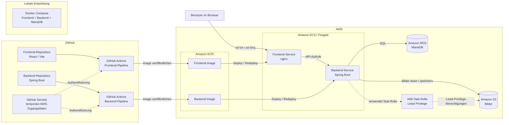
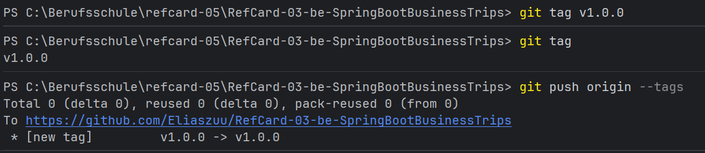
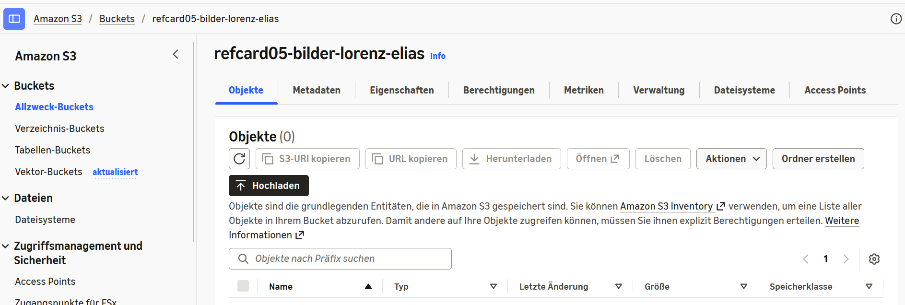
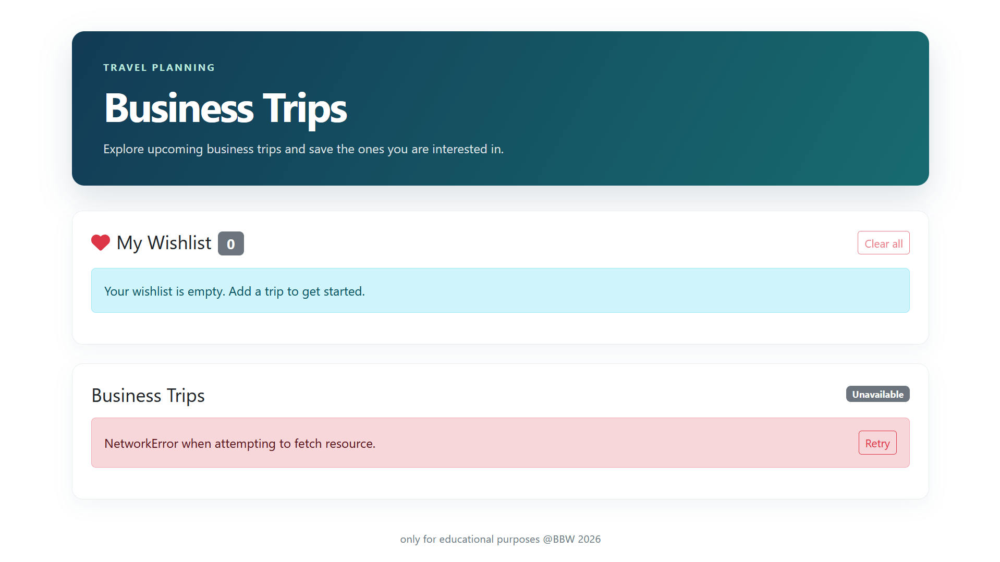
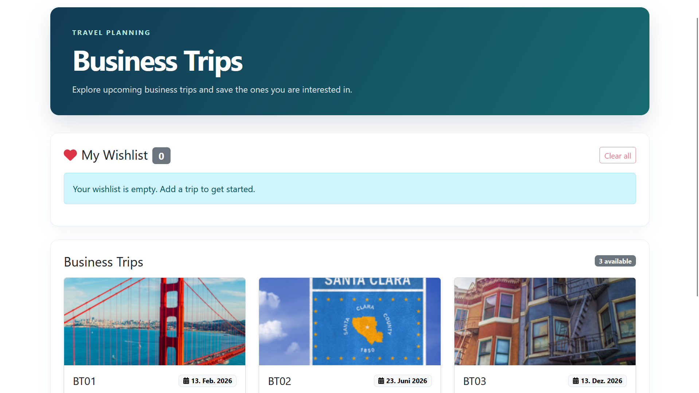

# M324 – RefCard05: Full-Stack-Anwendung auf AWS

## 1. Überblick

**Projekt:** RefCard05 – Full-Stack-Anwendung auf AWS  
**Team / Autorinnen und Autoren:** Lorenz, Elias    
**Datum / Version der Dokumentation:** 17.11.2026  
**AWS-Region:** us-east-1

**Ausgangslage:** RefCard02 behandelte Frontend, GitHub Actions, EC2 und Docker; RefCard03 ergänzte das Spring-Boot-Backend mit MariaDB und CI/CD; RefCard04 behandelte Bilder-Storage als Vorstufe zu S3. RefCard05 führt diese Teile zu einer Full-Stack-Anwendung auf AWS zusammen.

### Ziel

Ziel dieser Lernaufgabe ist es, die bestehende Full-Stack-Anwendung aus React/Vite-Frontend und Spring-Boot-Backend auf AWS bereitzustellen. Frontend und Backend liegen in getrennten GitHub-Repositories und erhalten jeweils eine eigene CI/CD-Pipeline. Diese baut und testet den jeweiligen Dienst, erstellt ein versioniertes Docker-Image und veröffentlicht es im eigenen Amazon-ECR-Repository. Die Images werden als getrennte Services auf Amazon ECS mit Fargate betrieben; Änderungen an den Images sollen ein automatisches Redeployment auslösen.

Das Backend wird mit einer MariaDB-Datenbank auf Amazon RDS verbunden und speichert Bilder in einem Amazon-S3-Bucket. Die RDS-Verbindungsdaten werden konfiguriert, ohne sie im Quellcode abzulegen. Der Zugriff auf den konkreten S3-Bucket wird für den Backend-Task nach dem Least-Privilege-Prinzip begrenzt. Berücksichtigt werden die Einschränkungen des AWS Academy Learner Lab: OIDC und das Erstellen eigener IAM-Rollen sind dort nicht verfügbar; temporäre Session-Zugangsdaten werden als GitHub Secrets verwaltet und bei einer neuen Session erneuert. Zusätzlich soll sich die Anwendung lokal mit Docker Compose (Frontend, Backend und MariaDB) starten lassen, ohne AWS-Zugang.

### Architektur

Die durchgezogenen Pfeile zeigen Daten- und Deployment-Flüsse. Gestrichelte Pfeile zeigen die Verwendung von Zugangsdaten beziehungsweise Berechtigungen. Für die lokale Entwicklung startet Docker Compose Frontend, Backend und MariaDB gemeinsam; dieser Ablauf ist unabhängig von den AWS-Services. Das Diagramm zeigt die in der Aufgabe vorgesehene Architektur, nicht den Nachweis, dass alle Services bereits erfolgreich eingerichtet sind.

## 2. Repositories und Zuständigkeiten

| Bereich | Repository                                                        | Zuständigkeit / wichtige Inhalte |
|---|-------------------------------------------------------------------|---|
| Frontend | https://github.com/Eliaszuu/refcard-03-fe-react-vite              | React/Vite-Frontend, Vite-Build hinter nginx, Dockerfile und eigene GitHub-Actions-Pipeline |
| Backend | https://github.com/Eliaszuu/RefCard-03-be-SpringBootBusinessTrips | Spring-Boot-Backend, Multi-Stage-Dockerfile (Maven-Build und JRE-Laufzeit), eigene Pipeline; Anbindung an RDS und S3 |
| Docker Compose | Im Backend Repo                                                   | Gemeinsamer lokaler Start von Frontend, Backend und MariaDB |

Die beiden Repositories werden unabhängig voneinander gebaut und veröffentlicht. Das Frontend spricht das Backend über dessen API an. 

## 3. CI/CD und Versionierung

### 3.1 Frontend-Pipeline

Die Frontend-Pipeline soll das Frontend bauen und testen, den Vite-Build für nginx in ein Docker-Image verpacken und das Image in das eigene ECR-Repository pushen. Die Backend-URL muss beim Frontend-Build als `VITE_API_BASE_URL` konfiguriert werden.

- Workflow-Datei
- ECR-Repository: 851725204375.dkr.ecr.us-east-1.amazonaws.com/refcard05-frontend
- Image-Tagging: Git-Tags sollen nachvollziehbar auf die Image-Version abgebildet werden.

### 3.2 Backend-Pipeline

Die Backend-Pipeline soll das Spring-Boot-Backend bauen und testen, mit einem Multi-Stage-Dockerfile ein Laufzeit-Image (Maven-Build und JRE) erstellen und in das eigene ECR-Repository pushen. 

- Workflow-Datei
- ECR-Repository: 851725204375.dkr.ecr.us-east-1.amazonaws.com/refcard05-backend
- Image-Tagging: gleiches nachvollziehbares Grundschema wie beim Frontend.

### 3.3 Git-Tags und Image-Versionen

Beide Images sollen strukturiert und nachvollziehbar versioniert werden. Die Git-Tags der Repositories müssen den jeweiligen Image-Tags in ECR zugeordnet werden können. Ein einheitliches Schema wie SemVer erleichtert den Vergleich der Frontend- und Backend-Versionen.

## 4. AWS-Konfiguration und Deployment

### 4.1 RDS / MariaDB

Vorgesehen ist eine MariaDB-Instanz auf Amazon RDS in `us-east-1`. Das Backend erhält Host, Port, Datenbankname und Benutzer über Konfiguration beziehungsweise Umgebungsvariablen; Passwörter werden nicht in den Quellcode geschrieben. Der Datenbankzugriff soll auf das Backend beschränkt sein.

- RDS-Instanz: refcard05-mariadb, refcard05-mariadb.cp8mygeaofaq.us-east-1.rds.amazonaws.com
- Datenbankname: refcard05-mariadb
- Verbindungskonfiguration: Host, Port, Datenbankname und Benutzer; Kennwort als Secret beziehungsweise geschützte Umgebungsvariable. 
- Netzwerkzugriff / Sicherheitsgruppe: Zugriff nur vom Backend beziehungsweise dessen Netzwerk auf den MariaDB-Port (standardmässig 3306).

### 4.2 S3-Bilder-Storage und IAM

Der Bilder-Endpoint des Backends wird von lokaler Speicherung auf Amazon S3 umgestellt. Das Backend lädt Bilder in den Bucket hoch und ruft sie bei Bedarf ab. Der ECS-Backend-Task erhält eine IAM-Task-Rolle, deren Berechtigungen auf den benötigten Bucket und die tatsächlich erforderlichen Aktionen beschränkt sind.

- S3-Bucket: 

- Backend-Konfiguration
- IAM-Rolle / Task-Rolle: 
- Least-Privilege-Berechtigungen: nur die für den Bilder-Workflow erforderlichen Aktionen auf dem konkreten Bucket beziehungsweise dessen Objekten. 
- Fehlerfall: Fehler bei fehlenden Berechtigungen oder S3-Ausfällen sollen nachvollziehbar behandelt werden. 

### 4.3 ECS-Services

| Service | Container / Image | ECS-Service / Cluster | Health-Check |
|---|---|-----------------------|--------------|
| Frontend | nginx / Frontend-Image aus ECR | frontend-service      | erfolgreich  |
| Backend | Spring Boot / Backend-Image aus ECR | biztrips-service      | erfolgreich  |

Frontend und Backend laufen als zwei getrennte ECS-Services auf Fargate. Der Frontend-Service verwendet nginx, der Backend-Service Spring Boot. Die Image-Änderung soll für beide Services automatisiert ein Redeployment auslösen.

## 5. Secrets und AWS Academy Learner Lab

Das Learner Lab stellt temporäre AWS-Zugangsdaten bereit. Diese werden als GitHub-Actions-Secrets gespeichert und von den Workflows für die AWS-Authentifizierung verwendet. In der Aufgabenstellung sind direkte Schlüssel für `aws-actions/configure-aws-credentials` vorgesehen, nicht `role-to-assume`. Session-Token und Schlüssel laufen ab und müssen nach Start einer neuen Lab-Session erneuert werden. Secret-Werte gehören weder in die Dokumentation noch in Quellcode, Commits oder Screenshots.

| Secret / Variable | Hinterlegt in | Zweck |
|---|---|---|
| `AWS_ACCESS_KEY_ID` | GitHub Actions Secrets | Temporärer Zugriff der CI/CD-Workflows auf AWS |
| `AWS_SECRET_ACCESS_KEY` | GitHub Actions Secrets | Temporärer Zugriff der CI/CD-Workflows auf AWS |
| `AWS_SESSION_TOKEN` | GitHub Actions Secrets | Session-Token für temporäre Learner-Lab-Zugangsdaten |
| RDS-Verbindungswerte | Geschützte ECS-/Anwendungskonfiguration | Verbindung des Backends mit RDS;  |

Nach Beginn einer neuen Learner-Lab-Session werden die aktuellen Werte aus dem AWS-Details-Panel in den entsprechenden GitHub Secrets aktualisiert. Anschliessend wird der Workflow erneut ausgeführt und der Zugriff überprüft.

**OIDC-Vergleich:** In einer Produktionsumgebung ist OIDC in der Regel vorzuziehen, weil GitHub Actions damit kurzlebige AWS-Berechtigungen beziehen kann, ohne dauerhaft gespeicherte AWS-Schlüssel zu benötigen. Im AWS Academy Learner Lab sind OIDC und das Erstellen eigener IAM-Rollen gemäss Aufgabenstellung nicht verfügbar; deshalb werden dort die temporären Lab-Zugangsdaten als Secrets genutzt.

## 6. Lokale Entwicklung mit Docker Compose

### Voraussetzungen

- Docker Desktop oder Docker Engine mit Docker Compose
- Zugriff auf das Backend-Repository; für eine spätere vollständige Anwendung zusätzlich auf das Frontend-Repository
- Java 21 wird für einen direkten lokalen Build benötigt; das Compose-Image führt den Maven-Build bereits in einem Multi-Stage-Dockerfile aus
- Eine nicht versionierte `.env`-Datei im Verzeichnis `docker` mit einem Wert für `DB_PASSWORD`
- Lokales `DB_PASSWORD` für MariaDB und phpMyAdmin; keine echten AWS-Zugangsdaten oder RDS-Passwörter in Git oder in der Compose-Datei speichern
- Das aktuelle Setup verwendet für Bilder das lokale Volume `/app/uploads`; das S3-Profil wird nur in der ECS-Konfiguration aktiviert

### Starten

1. Das Backend-Repository klonen und im Verzeichnis `docker` eine nicht versionierte `.env`-Datei mit `DB_PASSWORD=<lokales-Passwort>` erstellen.
2. Aus dem Verzeichnis `docker` die Datei mit `docker compose up --build` starten. Die Compose-Datei liegt unter `docker/docker-compose.yml`.
3. MariaDB verwendet den Datenbanknamen `db_biztrips`, den Benutzer `root` und das lokale `DB_PASSWORD`; der Health-Check wartet auf eine initialisierte InnoDB-Datenbank.
4. Nach erfolgreicher Prüfung startet das Backend auf Port `8080` mit `SPRING_PROFILES_ACTIVE=mariadb` und verbindet sich über den Container-Namen `bbw-mariadb-trips-dev` auf Port `3306`.
5. phpMyAdmin startet über den Health-Check erst nach MariaDB auf `http://localhost:8082`.
6. Das Backend ist unter `http://localhost:8080` erreichbar. Eine vollständige Browser-Anwendung ist erst verfügbar, wenn das Frontend ergänzt und mit dem Backend verbunden wird.
7. Das lokale Upload-Verzeichnis liegt unter dem Docker-Volume `uploads` und wird im Backend auf `/app/uploads` gemountet.
8. **Noch auszutesten:** Tatsächlich verwendete Docker-Compose-Version, Java-/Docker-Versionen, Startprotokoll, REST-Aufruf und Screenshots der laufenden Container.

### Stoppen und Fehlerbehebung

- Stoppen: `docker compose down` (im Compose-Verzeichnis)
- Logs anzeigen: `docker compose logs -f`
- Häufiges Problem: Ist ein verwendeter Port bereits belegt, den belegenden Dienst beenden oder die Port-Zuordnung in der Compose-Konfiguration anpassen.

Die Aufgabenstellung verlangt, Frontend, Backend und MariaDB gemeinsam lokal zu starten, sodass für die lokale Entwicklung kein AWS-Zugang nötig ist.

- Die vorhandene Konfiguration baut das Backend lokal aus dem Repository-`Dockerfile`; MariaDB und phpMyAdmin verwenden öffentlich verfügbare Images.
- Das MariaDB-Verzeichnis wird über `docker/database:/var/lib/mysql` persistent gemacht. Damit bleibt die Datenbank auch nach `docker compose down` erhalten, sofern das Verzeichnis nicht manuell gelöscht wird.
- Das Backend wird erst gestartet, wenn MariaDB den Compose-Health-Check besteht. phpMyAdmin wartet zusätzlich auf den gleichen Gesundheitszustand.
- Verwendete Ports: Backend `8080`, MariaDB `3306` und phpMyAdmin `8082`.
- Die vollständige gemeinsame Konfiguration für das React/Vite-Frontend fehlt noch; sie muss nach Abschluss in dieselbe Compose-Datei beziehungsweise in ein separates Compose-Verzeichnis aufgenommen werden.

## 7. Tests und Funktionsnachweise

| Bereich | Test / Vorgehen | Erwartetes und tatsächliches Ergebnis | Nachweis |
|---|---|---|---|
| Frontend | Frontend-Pipeline ausführen und die Anwendung im Browser aufrufen | Das Frontend liegt in einem eigenen Repository; die konkrete Pipeline und ein Browser-Test müssen im Frontend-Repository ergänzt und verlinkt werden. Im aktuellen Backend-Repository ist kein Frontend-Test vorhanden. | Noch zu ergänzen: Workflow-Lauf aus dem Frontend-Repository |
| Backend | Maven-Test und Maven-Package ausführen; REST-Endpunkte lokal beziehungsweise in ECS aufrufen | Die GitHub-Actions-Pipeline führt `./mvnw --batch-mode test` aus. Danach baut sie mit `clean package -DskipTests` ein Jar. Der ECS-Job baut daraus ein Docker-Image und startet ein Deployment; ein erfolgreicher Lauf muss mit dem GitHub-Run und einem API-Aufruf nachgewiesen werden. | `.github/workflows/deploy.yml`, `Dockerfile`, **noch zu ergänzen:** Workflow-Link und API-Antwort |
| Datenbank | Backend mit der MariaDB-Konfiguration starten und einen Datenbankzugriff auslösen | Das Backend unterstützt über das Profil `mariadb` eine JDBC-Verbindung zu MariaDB. ECS erhält Host, Port und Datenbankname über Umgebungsvariablen und Benutzer sowie Passwort über Secrets Manager. Vor dem Nachweis müssen die Variablennamen konsistent auf `DB_USERNAME` beziehungsweise `DB_PASSWORD` gesetzt werden. | `src/main/resources/application-mariadb.properties`, `task-definition.json`, **noch zu ergänzen:** ECS-Log oder Screenshot ohne Secrets |
| Bilder | Profilbild über einen Employee-Endpunkt hochladen, abrufen und löschen | Das S3-Profil aktiviert einen `S3ProfilePictureStorage`, der Dateien unter `employee-photos/` speichert und nur Schlüssel mit diesem Präfix zulässt. Die Policy-Vorlage erlaubt `GetObject`, `PutObject` und `DeleteObject`. Ein Bucket-Name, die ECS-Task-Rolle und ein erfolgreicher Upload müssen noch praktisch nachgewiesen werden. | `src/main/java/ch/bbw/trips/storage/S3ProfilePictureStorage.java`, `aws/s3-profile-photos-policy.json`, **noch zu ergänzen:** Bucket-Screenshot |
| Deployment | Neue Backend-Image-Version pushen und ECS-Service stabilisieren lassen | Der Workflow pusht den Commit-SHA oder den Git-Tag nach ECR und ersetzt anschliessend das Backend-Image in der ECS-Task-Definition. Die ECR-Image-Version und der ECS-Service müssen nach einem Lauf auf die gleiche Revision geprüft werden. | `.github/workflows/deploy.yml`, `task-definition.json`, **noch zu ergänzen:** ECR- und ECS-Screenshot |
| Lokal | `docker compose` für MariaDB und Backend starten | Die Compose-Konfiguration baut das Backend aus dem lokalen `Dockerfile`, startet MariaDB auf Port `3306` und das Backend auf Port `8080`. MariaDB muss über einen Health-Check gesund sein, bevor das Backend startet. Das Upload-Verzeichnis wird als Volume `/app/uploads` persistent gehalten; phpMyAdmin läuft zusätzlich auf Port `8082`. Das vollständige Frontend-Compose-Setup fehlt. | `docker/docker-compose.yml`, lokale URL `http://localhost:8080`, phpMyAdmin `http://localhost:8082`, **noch zu ergänzen:** Compose-Screenshot |

## 8. Individuelle Umsetzung und Nachvollziehbarkeit

Die individuelle Umsetzung soll über Commits, Pull Requests und Workflow-Läufe in beiden Repositories nachvollziehbar sein. 

| Person | Beitrag | Commit / PR / Workflow |
|---|---|---|
| Lorenz | AWS | Erstellen der Sachen in AWS|
| Elias | Github workflows | Github Workflows erstellt und dockerfile angepasst |

## 9. Herausforderungen und Erkenntnisse

### Herausforderungen

- Die temporären AWS-Zugangsdaten des Learner Labs laufen mit der Session ab und müssen erneuert werden. Das haben wir gemerkt, als wir eine Woche später nochmals versucht haben, die Pipeline laufen zu lassen. Wir haben es gelöst, indem wir die Tokens aktualisiert haben.

- OIDC und das Erstellen eigener IAM-Rollen sind im Learner Lab eingeschränkt. Die Backend-Pipeline verwendet deshalb temporäre Lab-Zugangsdaten aus GitHub-Secrets statt `role-to-assume`.
- Die Pipeline wird bei `push` auf `main`, bei passenden Git-Tags `v*` und bei Pull Requests auf `main` ausgelöst. Pull Requests führen nur Build und Tests aus; Pushes und Tags lösen zusätzlich den ECR-Push und das ECS-Deployment aus.
- Beim erneuten Anlegen einer Lab-Session können sowohl AWS-Zugangsdaten als auch die Weitergabe von ECS-/RDS-/S3-Konfigurationen ungültig werden. Variablen und Secrets müssen daher gemeinsam mit der Session geprüft und aktualisiert werden.
- Der Repository-Stand enthält noch keine nachgewiesene Frontend-Pipeline und kein gemeinsames Compose-Setup für Frontend, Backend und MariaDB. Die vorhandene Compose-Datei startet nur Backend, MariaDB und phpMyAdmin.
- Bei der Datenbankkonfiguration wurde eine Namensabweichung erkannt: Compose und ECS arbeiten mit `DB_USERNAME`, die MariaDB-Konfiguration liest aktuell `DB_USER`. Dadurch kann die Verbindung je nach eingesetztem Profil fehlschlagen, wenn die Variablen nicht zusätzlich angepasst werden.

### Erkenntnisse

- **CI/CD trennt Prüfung und Deployment sinnvoll:** Maven-Test und Maven-Package laufen in einem eigenen `verify`-Job. Erst ein erfolgreicher Push kann den ECR-/ECS-Job starten. Das verhindert, dass Pull Requests Änderungen direkt in AWS veröffentlichen.
- **Mehrere Image-Tags erhöhen die Nachvollziehbarkeit:** Der Workflow veröffentlicht den Commit-SHA als Tag, bei Git-Tags zusätzlich den Git-Tag und bei normalen Branch-Pushes ausserdem `latest`. Dadurch ist ein ECS-Deployment sowohl reproduzierbar als auch leicht zu identifizieren.
- **Infrastrukturparameter gehören nicht in das Image:** Die Task-Definition wird erst in der Pipeline aus Variablen und Secrets ergänzt. RDS-Host, Datenbankname, Port und S3-Bucket werden als Umgebungseinstellungen gesetzt; Benutzername und Passwort werden über Secrets Manager-ARNs injiziert.
- **Das Backend ist für MariaDB und S3 vorbereitet:** Das ECS-Deployment aktiviert `SPRING_PROFILES_ACTIVE=mariadb,s3`. Das Docker-Image enthält eine S3-Client-Konfiguration und einen eigenen Storage-Service für Profilbilder.
- **Least Privilege ist durch eine konkrete Policy-Vorlage sichtbar:** Die Vorlage erlaubt auf Objekten unter `employee-photos/*` nur `GetObject`, `PutObject` und `DeleteObject`. Vor dem Einsatz muss der Platzhalter-Bucketname durch den tatsächlichen Bucket ersetzt werden.
- **Docker-Images können schlank gehalten werden:** Das Backend verwendet einen Multi-Stage-Build mit JDK 21 für Maven und JRE 21 für die Laufzeit. Das Container-Image enthält dadurch keinen vollständigen Maven-Build-Toolchain.
- **Compose hat einen klaren lokalen Zweck, aber noch nicht den vollständigen RefCard-05-Umfang:** Backend und Datenbank starten mit einem Health-Check sowie einem persistenten Upload-Volume. Die Frontend-Konfiguration und die gemeinsame Orchestrierung fehlen im aktuellen Backend-Repository.
- **Konfiguration muss end-to-end konsistent geprüft werden:** Ein erfolgreiches Docker- oder Maven-Build sagt noch nichts über das ECS-Laufzeitverhalten aus. Besonders Datenbankvariablen, Secrets Manager-ARNs, Sicherheitsgruppen und Bucket-Berechtigungen müssen gemeinsam getestet werden.
- **Geheimnisse müssen sichtbar geschützt bleiben:** Die Workflow-Datei verwendet Variablen und Secrets, enthält aber keine konkreten Schlüssel oder Kennwörter. Alle tatsächlichen Werte gehören in GitHub-Secrets beziehungsweise geschützte AWS-Konfiguration und nicht in Dokumentation oder Screenshots.

Website, wenn Backend nicht funktioniert, weil RDS nicht erreichbar ist.

Website, wenn Backend und Deployment funktioniert.
